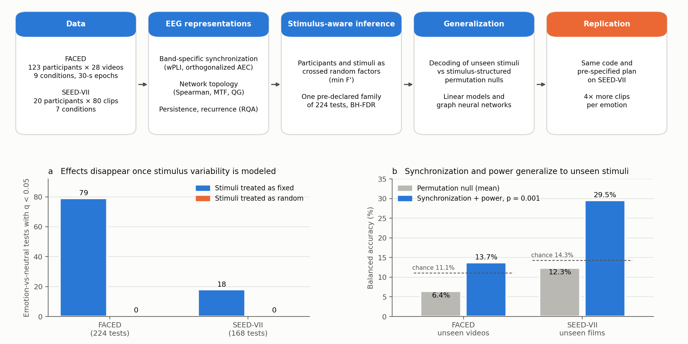
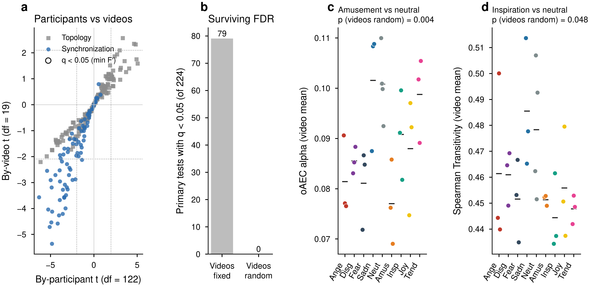
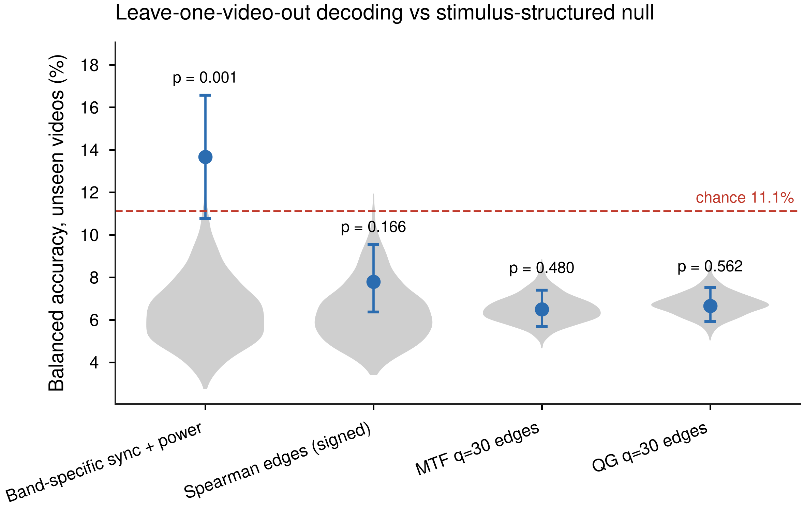
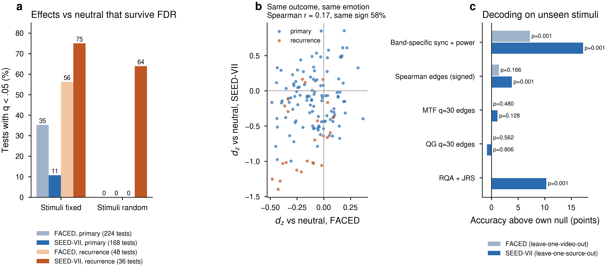

# EEG network organization across affective video conditions

[](LICENSE)
[](requirements.txt)
[](https://doi.org/10.1038/s41597-023-02650-w)
[](https://bcmi.sjtu.edu.cn/~seed/seed-vii.html)

Code accompanying

> **Alves C. L., Kalbasi A., Saccaro L. F., Andrianarivelo N., Panzeri A., Bellone C.**
> EEG network organization across affective video conditions: complementary nonlinear representations,
> topological summaries, and synchronization–topology coupling. *Chaos, Solitons & Fractals* (under review).

<p align="center"></p>

## Overview

Naturalistic affective EEG studies present each emotion through a small set of video clips, so effects that
are consistent across participants can still be specific to the clips. This repository implements a
stimulus-aware analysis of EEG network organization in the FACED dataset (123 participants, 28 videos, nine
affective conditions) and its independent replication in SEED-VII (20 participants, 80 clips):

* **Representations**: band-specific synchronization (weighted phase-lag index, orthogonalized
  amplitude-envelope correlation), topology of three complementary network representations (Spearman channel
  networks, Markov-transition-field and quantile-graph state-transition networks), persistent homology and
  recurrence quantification.
* **Inference**: emotion-versus-neutral contrasts with participants **and** stimuli as crossed random factors
  (min F′), in one pre-declared family of 224 tests with false-discovery-rate control.
* **Generalization**: decoding of the condition of unseen stimuli against stimulus-structured permutation
  nulls, with linear classifiers and pre-registered graph neural networks.
* **Validity**: surrogate and independent-segment null models, quantile and density sweeps, muscle-artifact
  checks, signed networks, metric persistence filtrations.

## Key results

| | |
|:--:|:--:|
|  |  |
| **Fig. 2** · 79 of 224 contrasts survive correction when videos are treated as fixed, none when videos are random. | **Fig. 3** · Band-specific synchronization and power decode the condition of unseen videos above a stimulus-structured null (13.7% vs 6.4%, *p* = 0.001). |

<p align="center"></p>
<p align="center"><b>Fig. S8</b> · Independent replication in SEED-VII: no contrast survives with stimuli random (18 of 168 with stimuli fixed), and synchronization and power again decode unseen stimuli (29.5% vs 12.3%).</p>

## Repository structure

```
├── faced/                    FACED, released 30-s epochs (Sections 2–3.1, Appendices A–B)
│   ├── src/                  pipeline: 00_load_epochs → 01/02 features → 03 contrasts → fig*/sensitivity_*
│   │   └── gnn/              graph neural networks (training, run configurations, Fig. S7)
│   ├── figures/              Figs. 1–3, S1–S7
│   ├── tables/               every test and model summary (all_contrasts.csv lists all 616 FACED tests) and
│   │                         the decoding permutation null distributions
│   ├── results/gnn/          every graph-network run, including all permutations
│   └── preregistration/      model-selection rule and its amendments
├── seed_vii/                 independent replication in SEED-VII (Section 3.2, Appendix C; Fig. S8)
│   ├── src/  figures/  tables/
│   ├── ANALYSIS_PLAN.md      plan written before the data were analyzed, with a log of every later addition
│   └── run_all.sh
├── faced_1s_exploratory/     exploratory final-second analyses and behavioral analyses (Sections 3.3–3.5,
│                             Appendices D–K; Figs. 4–6, S9–S29)
├── multiplex_gnn/            complementary recurrence-multiplex graph network, GPU (Appendix B), with the
│                             observed and permutation scores and the randomized-graph control
├── demo/                     one-minute demonstration on simulated data
└── docs/                     overview figure
```

## System requirements

* **Operating system**: tested on Linux (Ubuntu 20.04 LTS); expected to run on any system with Python 3.11.
* **Software**: Python 3.11 with the package versions in [`requirements.txt`](requirements.txt) (numpy,
  scipy, pandas, scikit-learn, statsmodels, torch, matplotlib, mne, joblib, networkx, gudhi). The 1-s
  analyses use [`faced_1s_exploratory/requirements.txt`](faced_1s_exploratory/requirements.txt).
* **Hardware**: a standard computer runs the demo and the statistics. The full feature extraction is
  CPU-intensive (FACED: about 30 CPU-hours; SEED-VII: about 3 hours on 12 cores). Only the complementary
  multiplex network requires a GPU.

## Installation

```bash
git clone https://github.com/Caroline070590/EEG_emotions_CSF.git
cd EEG_emotions_CSF
conda env create -f environment.yml && conda activate eeg-emotions-csf   # or: pip install -r requirements.txt
```

Typical installation time: about 5 minutes.

## Demo

The demo simulates a FACED-like design (40 participants × 28 videos) with one feature that carries a
condition effect shared by all videos and one that carries only video-specific fingerprints, and applies the
two core procedures of the paper: stimulus-aware contrasts and decoding of unseen videos.

```bash
python demo/run_demo.py
```

Expected output ([`demo/expected_output.txt`](demo/expected_output.txt)); run time about 15 s:

```
1. Emotion-versus-neutral tests (p < 0.05 out of 8 contrasts)
   feature_A_condition    participants random only: 8/8   participants + videos random: 7/8
   feature_B_video_only   participants random only: 7/8   participants + videos random: 0/8

2. Decoding the condition of unseen videos (leave-one-video-out, 200 permutations)
   feature_A_condition    accuracy  7.4%   null mean  1.5%   p = 0.010
   feature_B_video_only   accuracy  0.3%   null mean  2.1%   p = 0.975
```

The video-specific feature looks significant when videos are treated as fixed, but not when videos are
random, and it does not decode unseen videos.

## Reproducing the analyses

**1. FACED, 30-s epochs** (from `faced/`; set `FACED_ZIP` to the exported epochs; `N_JOBS` sets the number of
parallel workers):

```bash
cd faced/src
python 00_load_epochs.py
python 01_trial_features.py
python 02_recurrence_features.py --chunk 0 1 && python 02_recurrence_features.py --merge 1
python 03_stimulus_aware_contrasts.py
python fig1_fig2_synchronization_and_stimulus.py && python fig3_decoding_unseen_videos.py
for f in figS*.py sensitivity_*.py; do python "$f"; done
```

Graph neural networks: `gnn/run_gnn.py` (one run per call; each line of `gnn/configs/*.txt` gives the arguments
of one run), then
`gnn/summarize_paired.py` and `gnn/figS7_gnn_models.py`.

**2. SEED-VII** (from `seed_vii/`): `./run_all.sh /path/to/SEED-VII` (about 3 hours on 12 cores).

**3. FACED, final 1-s segments**: see [`faced_1s_exploratory/README.md`](faced_1s_exploratory/README.md).

## Figures

| Figure | Script |
|---|---|
| 1, 2 | `faced/src/fig1_fig2_synchronization_and_stimulus.py` |
| 3 | `faced/src/fig3_decoding_unseen_videos.py` |
| 4 | `faced_1s_exploratory/src/part1_topology/run_part1_q30.py` |
| 5 | `faced_1s_exploratory/src/part2_synchrony/run_part2.py` |
| 6 | `faced_1s_exploratory/src/part4_regional/run_figure4_full_composite.py` |
| S1–S6 | `faced/src/figS1_quantile_density_sweep.py` … `figS6_recurrence_statistics.py` |
| S7 | `faced/src/gnn/figS7_gnn_models.py` |
| S8 | `seed_vii/src/figS8_compare_with_faced.py` |
| S9 | `faced_1s_exploratory/src/part6_advanced/run_density_sweep_q30.py` |
| S10 | `faced_1s_exploratory/src/part1_topology/run_chords_supp_q30.py` |
| S11, S12 | `faced_1s_exploratory/src/part1_topology/run_bootstrap_effects.py`, `run_pairwise.py` |
| S13 | `faced_1s_exploratory/src/part3_embedding_topology/run_umap_q30.py` |
| S14 | `faced_1s_exploratory/src/part6_advanced/run_splithalf_q30_consolidated.py` |
| S15–S17 | `faced_1s_exploratory/src/part6_advanced/run_nbs.py`, `run_centrality_topo.py` |
| S18 | `faced_1s_exploratory/src/part6_advanced/run_nbs_threshold_sensitivity.py` |
| S19 | `faced_1s_exploratory/src/part6_advanced/run_region_coupling_splithalf.py` |
| S20 | `faced_1s_exploratory/src/part4_regional/run_part4_mtf_only_fancy_v2.py` |
| S21 | `faced_1s_exploratory/src/part5_enrichment/run_network_enrichment.py` |
| S22 | `faced_1s_exploratory/src/part6_advanced/run_richclub.py`, `run_richclub_mtf_q30.py` |
| S23 | `faced_1s_exploratory/src/part6_advanced/run_participant_averaging_sensitivity.py` |
| S24 | generator not recovered (leave-one-participant-out stability) |
| S25 | `faced_1s_exploratory/src/part6_advanced/run_contrast_splithalf.py` |
| S26 | `faced_1s_exploratory/src/stimulus_aware/stimulus_aware_validation_pipeline.py` |
| S27–S29 | `faced_1s_exploratory/src/behavioral/behavioral_grounding.py` |

## Data availability

No EEG data are redistributed here.

* **FACED**: Chen J., Wang X., Huang C., Hu X., Shen X., Zhang D. A large finer-grained affective computing
  EEG dataset. *Scientific Data* 10, 740 (2023). doi:[10.1038/s41597-023-02650-w](https://doi.org/10.1038/s41597-023-02650-w).
* **SEED-VII**: Jiang W.-B., Liu X.-H., Zheng W.-L., Lu B.-L. SEED-VII: a multimodal dataset of six basic
  emotions with continuous labels for emotion recognition. *IEEE Trans. Affect. Comput.* 16, 969–985 (2025).
  doi:[10.1109/TAFFC.2024.3485057](https://doi.org/10.1109/TAFFC.2024.3485057). Available on request from the
  [BCMI laboratory](https://bcmi.sjtu.edu.cn/~seed/seed-vii.html); the license does not permit redistribution.

## Citation

Please cite the article above (see also [`CITATION.cff`](CITATION.cff)).

## License

[MIT](LICENSE).
