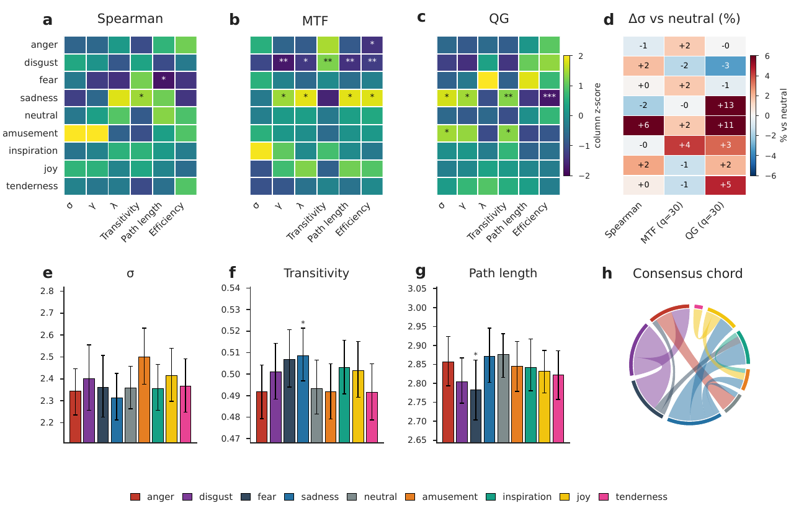
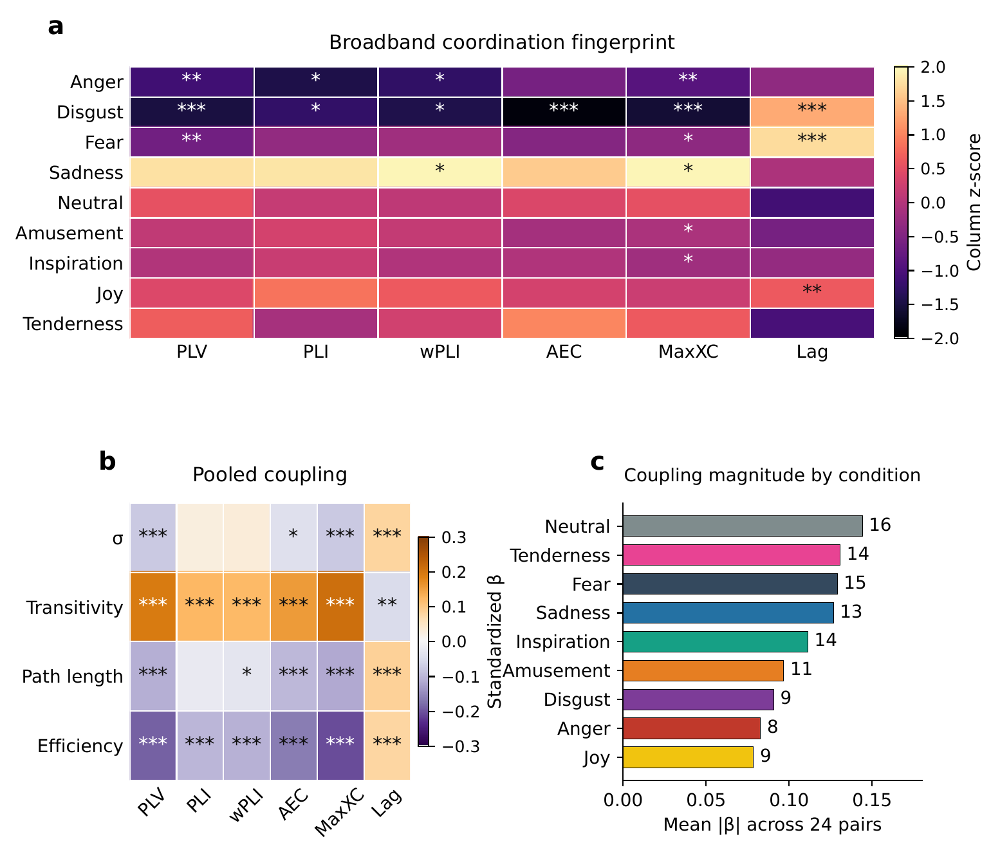
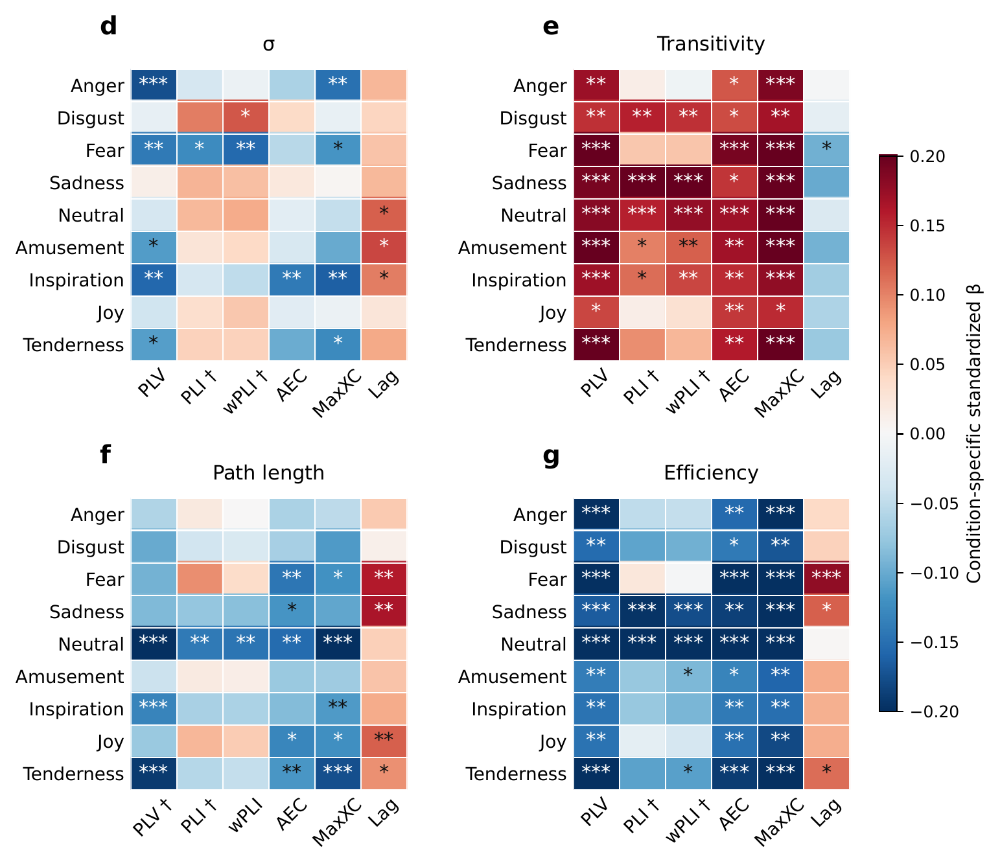
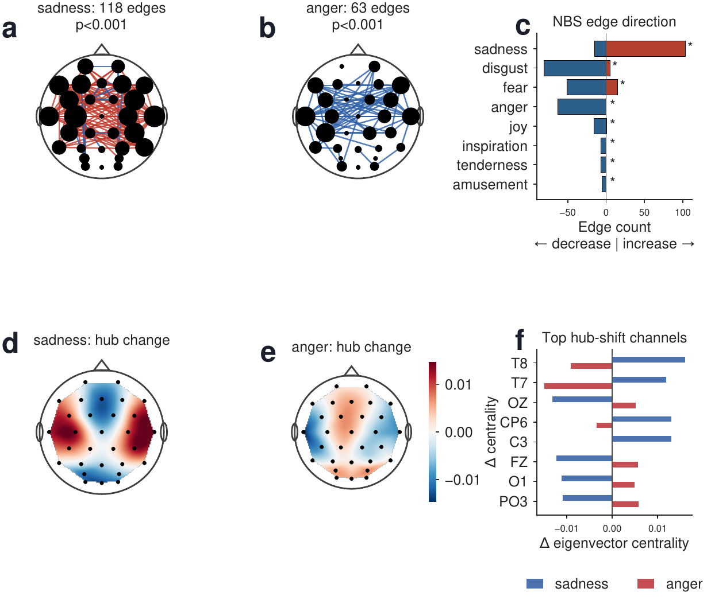
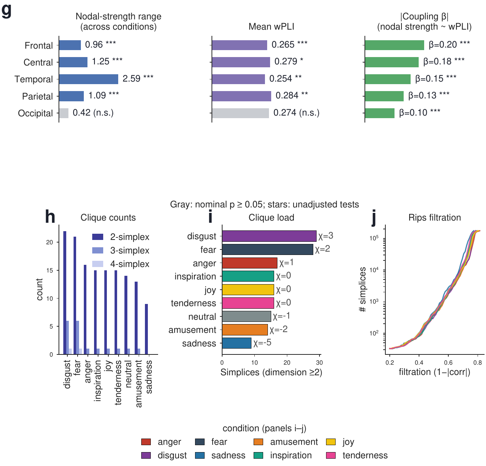

# EEG network organization across affective video conditions

[](LICENSE)
[](requirements.txt)
[](https://doi.org/10.1038/s41597-023-02650-w)
[](https://bcmi.sjtu.edu.cn/~seed/seed-vii.html)

Code accompanying

> **Alves C. L., Kalbasi A., Saccaro L. F., Andrianarivelo N., Panzeri A., Bellone C.**
> EEG network organization across affective video conditions: complementary nonlinear representations,
> topological summaries, and synchronization–topology coupling. *Chaos, Solitons & Fractals* (under review).

## Overview

The point-by-point review adds documented terminal-segment verification, corrected persistence-figure labels, and reconciled archive instructions. Reviewer coverage and source-change provenance are recorded in `revision_2026-10-25/provenance/point_by_point/`. Numerical outcomes are unchanged.

This repository accompanies the one-second FACED network analysis and its supplementary validation. The main study compares Spearman channel networks, Markov-transition-field and quantile-graph representations, their topological summaries, and synchronization–topology associations. The retained main figures use one 250-sample segment per participant and video (123 participants, 28 videos). The supplementary 30-s analyses examine duration, participant and stimulus dependence, prediction, and alternative EEG descriptions.

The supplementary prediction pipelines ask distinct questions: held-stimulus analyses test generalization across clips; participant-held-out analyses test familiar clips in new participants. Matched EEGNet augmentations compare the incremental predictive utility of connectivity and recurrence summaries. Feature-group perturbations of a fitted GNN measure model reliance, rather than incremental information over synchronization. Neither analysis directly validates the Spearman/MTF/QG scalar topology claims.

The exploratory FACED GNN development used full-FACED calibration. The retained planning documents and conditional label permutations do not make it an independently preregistered or confirmatory architecture test. The input-matched LDA and GNNs have different fitting procedures, so their comparison does not isolate architecture alone. In SEED-VII, sessions and conditions are associated; participant-held-out prediction and source-held-out analyses must retain their respective session limitations.

Original-file hashes and superseded source versions of the earlier release are retained in `revision_2026-10-25/provenance/`.

## Main figures

The three main figures of the article (one-second FACED analysis; 123 participants, 28 videos). The PDFs in [`figures/`](figures/) are identical to the manuscript figures; the PNGs are previews.

**Figure 1. Global topology and representation complementarity across affective video conditions.** Emotion-by-metric topology fingerprints for Spearman channel networks, Markov-transition-field (MTF) and quantile-graph (QG) networks, change in small-world coefficient relative to neutral, and condition-wise topology summaries.



**Figure 2. Synchronization fingerprints and condition-specific synchronization–topology coupling.** Condition-by-synchronization fingerprint and pooled coupling from participant-clustered models (a–c), and condition-specific coupling slopes (d–g).




**Figure 3. Multiscale EEG network organization across affective video conditions.** Network-based-statistic components and hub changes (a–f), regional nodal strength, wPLI and coupling (g), and clique and simplicial-complex summaries (h–j).




## Repository structure

```
figures/                     Main Figs. 1–3 as in the manuscript (PDF) with PNG previews
faced_1s_exploratory/        Main one-second FACED analyses (main Figs. 1–3) and retained sensitivity analyses
faced/                       Supplementary FACED 30-s validation, including held-video decoding
seed_vii/                    Supplementary SEED-VII analyses; separate within-dataset fitting
multiplex_gnn/               Earlier recurrence-multiplex analyses and graph controls
revision_2026-10-25/
  sources/                   Readable frozen sources for participant GNN/LDA, matched EEGNet, preprocessing diagnostic
  results/                   Verified Tables S2–S4 outputs, all-seed comparisons, source archives and configs
  retained_runs/             All 908 run records and OOF predictions: 304 FACED + 304 SEED-VII + 300 EEGNet folds
  corrections/               Corrected wPLI/behavior/session analyses, figure reconstruction and derived inputs
  provenance/               Original-release hashes, superseded files, staging and scope checks
  REVIEW_CHECKLIST.md        Completed checks and explicit remaining integration/provenance gaps
demo/                        Simulated-data demonstration
docs/                        Historical overview asset (not the current figure-number map)
```

## System requirements

* **Operating system**: tested on Linux (Ubuntu 20.04 LTS); expected to run on any system with Python 3.11.
* **Software**: Python 3.11 with the package versions in [`requirements.txt`](requirements.txt) (numpy,
  scipy, pandas, scikit-learn, statsmodels, torch, matplotlib, mne, joblib, networkx, gudhi). The 1-s
  analyses use [`faced_1s_exploratory/requirements.txt`](faced_1s_exploratory/requirements.txt).
* **Hardware**: a standard computer runs the demo and the statistics. The full feature extraction is
  CPU-intensive (FACED: about 30 CPU-hours; SEED-VII: about 3 hours on 12 cores). The matched EEGNet and complementary
  multiplex-network training use GPUs; their recorded environments and configurations accompany the frozen sources.

## Installation

Clone this repository (or extract the accompanying reproducibility archive) and run the following from its root.

```bash
conda env create -f environment.yml && conda activate eeg-emotions-csf   # or: pip install -r requirements.txt
```

Typical installation time: about 5 minutes.

## Demo

The demo simulates a FACED-like design (40 participants × 28 videos) with one feature that carries a
condition effect shared by all videos and one that carries only video-specific fingerprints, and applies the
two core procedures of the paper: stimulus-aware contrasts and decoding of unseen videos.

```bash
python demo/run_demo.py
```

Expected output ([`demo/expected_output.txt`](demo/expected_output.txt)); run time about 15 s:

```
1. Emotion-versus-neutral tests (p < 0.05 out of 8 contrasts)
   feature_A_condition    participants random only: 8/8   participants + videos random: 7/8
   feature_B_video_only   participants random only: 7/8   participants + videos random: 0/8

2. Decoding the condition of unseen videos (leave-one-video-out, 200 permutations)
   feature_A_condition    accuracy  7.4%   null mean  1.5%   p = 0.010
   feature_B_video_only   accuracy  0.3%   null mean  2.1%   p = 0.975
```

The video-specific feature looks significant when videos are treated as fixed, but not when videos are
random, and it does not decode unseen videos.

## Reproducing the analyses

**1. FACED, 30-s epochs** (from `faced/`; set `FACED_ZIP` to the exported epochs; `N_JOBS` sets the number of
parallel workers):

```bash
cd faced/src
python 00_load_epochs.py
python 01_trial_features.py
python 02_recurrence_features.py --chunk 0 1 && python 02_recurrence_features.py --merge 1
python 03_stimulus_aware_contrasts.py
python fig1_fig2_synchronization_and_stimulus.py && python fig3_decoding_unseen_videos.py
for f in figS*.py sensitivity_*.py; do python "$f"; done
```

Graph neural networks: `gnn/run_gnn.py` (one run per call; each line of `gnn/configs/*.txt` gives the arguments
of one run), then
`gnn/summarize_paired.py` and `gnn/figS7_gnn_models.py`.

**2. SEED-VII** (from `seed_vii/`): `./run_all.sh /path/to/SEED-VII` (about 3 hours on 12 cores).

**3. FACED, final 1-s segments**: see [`faced_1s_exploratory/README.md`](faced_1s_exploratory/README.md).

## Figures and supplementary tables

Numbering below follows the restored one-second main-paper structure. Historical filenames retain old numbers and are not reliable identifiers of the current manuscript location.

| Current item | Generator or retained source |
|---|---|
| Main 1: topology | `faced_1s_exploratory/src/part1_topology/run_part1_q30.py` |
| Main 2: synchronization and coupling | `revision_2026-10-25/corrections/analyses/figure4_s15/render_synchrony.py`; coefficients from verified 3,444-trial participant-clustered OLS |
| Main 3: multiscale and regional network organization | `revision_2026-10-25/corrections/analyses/figures/part4_regional/run_figure5_corrected.py` |
| S1–S6 | `faced/src/figS1_quantile_density_sweep.py` … `figS6_recurrence_statistics.py` |
| S7 | `faced/src/gnn/figS7_gnn_models.py` |
| S8 | `seed_vii/src/figS8_compare_with_faced.py` |
| S9 | `faced_1s_exploratory/src/part6_advanced/run_density_sweep_q30.py` |
| S10 | `faced_1s_exploratory/src/part1_topology/run_chords_supp_q30.py` |
| S11–S12 | `faced_1s_exploratory/src/part1_topology/run_bootstrap_effects.py`, `run_pairwise.py` |
| S13–S14 | `faced_1s_exploratory/src/part3_embedding_topology/run_umap_q30.py`, `src/part6_advanced/run_splithalf_q30_consolidated.py` |
| S15–S18 | `faced_1s_exploratory/src/part6_advanced/run_nbs.py`, `run_centrality_topo.py`, `run_nbs_threshold_sensitivity.py` |
| S19 | `faced_1s_exploratory/src/part6_advanced/run_region_coupling_splithalf.py` |
| S20 | `faced_1s_exploratory/src/part4_regional/run_part4_mtf_only_fancy_v2.py` |
| S21–S22 | `faced_1s_exploratory/src/part5_enrichment/run_network_enrichment.py`, `src/part6_advanced/run_richclub.py`, `run_richclub_mtf_q30.py` |
| S23: participant averaging | `faced_1s_exploratory/src/part6_advanced/run_participant_averaging_sensitivity.py`; reconstructed generator, not exact historical provenance |
| S24: leave-one-participant-out stability | `faced_1s_exploratory/lopo_stability_S24/` (original July outputs verified; recomputed at q = 30 with Greenhouse–Geisser correction) |
| S25: contrast split halves | `faced_1s_exploratory/src/part6_advanced/run_contrast_splithalf.py` |
| S26: one-second stimulus sensitivity | `faced_1s_exploratory/src/stimulus_aware/stimulus_aware_validation_pipeline.py` |
| S27–S29: behavioral validation, modeling, RSA | `revision_2026-10-25/corrections/analyses/behavioral/`; corrected J4 prediction and retained association/RSA provenance |
| S30: participant versus video inference | `faced/src/fig1_fig2_synchronization_and_stimulus.py` (historical Fig2 asset) |
| S31: 30-s synchronization | Same generator (historical Fig1 asset) |
| S32: 30-s held-video decoding | `faced/src/fig3_decoding_unseen_videos.py` |
| Table S2: input-matched participant prediction | `revision_2026-10-25/sources/gnn_faced/` and `gnn_seed7/` |
| Table S3: all-seed matched EEGNet | `revision_2026-10-25/sources/matched_eegnet/`; `results/seed_stability/` |
| Table S4: preprocessing sensitivity | `revision_2026-10-25/sources/eegnet_preprocessing_diagnostic/`; `results/preprocessing_diagnostic/` |

The recovered behavioral-RSA filename `Supplementary_Figure_S24_behavioral_neural_RSA` refers to current S29. It is unrelated to current S24 (leave-one-participant-out stability).

The latest prediction pipelines retain all seeds (20261024, 11, 29) and all planned models. Primary EEGNet trial scores average three nonoverlapping 10-s probabilities or use one 30-s input, so both primary designs use the complete 30 seconds. The post-result nine-fit preprocessing diagnostic is a sensitivity analysis, not a published-benchmark replication or a new selected baseline. See `revision_2026-10-25/README.md` for exact scope and rerunning reports.

## Data availability

No EEG data are redistributed here.

* **FACED**: Chen J., Wang X., Huang C., Hu X., Shen X., Zhang D. A large finer-grained affective computing
  EEG dataset. *Scientific Data* 10, 740 (2023). doi:[10.1038/s41597-023-02650-w](https://doi.org/10.1038/s41597-023-02650-w).
* **SEED-VII**: Jiang W.-B., Liu X.-H., Zheng W.-L., Lu B.-L. SEED-VII: a multimodal dataset of six basic
  emotions with continuous labels for emotion recognition. *IEEE Trans. Affect. Comput.* 16, 969–985 (2025).
  doi:[10.1109/TAFFC.2024.3485057](https://doi.org/10.1109/TAFFC.2024.3485057). Available on request from the
  [BCMI laboratory](https://bcmi.sjtu.edu.cn/~seed/seed-vii.html); the license does not permit redistribution.

## Citation

Please cite the article above (see also [`CITATION.cff`](CITATION.cff)).

## License

[MIT](LICENSE).
